# Лабораторная 3

## ЧАСТЬ 0 - Выбор СУБД

Для лабораторной работы я выбрала PostgreSQL, потому что мой сервис будет связан с созданием и отображением заказов. Данные заказов будут иметь понятную структуру - табличную, а в дальнейшем, если рассматривать развитие сервиса, эти даные будет удобно связывать с покупателями и товарами через таблицы. PostgreSQL позволяет задавать ограничения целостности и использовать транзакции, чтобы несколько связанных изменений сохранялись или отменялись вместе.

MongoDB хранит данные в документах и удобна для объектов с вложенными данными и различающейся структурой. Она тоже поддерживает транзакции и подходит для сервиса заказов, но для моей задачи табличная модель PostgreSQL понятнее и удобнее.

Также выбор PostgreSQL позволит мне изучить настройку streaming replication между primary и standby и выполнить ручное переключение на реплику при отказе основного узла.

---

## Часть 1 - Поднятие репликации

Я начала читать статью https://habr.com/ru/companies/otus/articles/710956/, чтобы по больше узнать как писать `docker-compose`, выяснить что-нибудь интересное и научиться чему-то новому. Как раз на основе этой статьи я начала писать `docker-compose`, в `Docker Hub` я почитала про образ, поменяла переменные, а также взяла оттуда имаж и тег.

> В статье есть блок, который упоминает про метрики, и оказывается, что постгресу нужен `postgres_exporter`, который будет в удобном формате записывать метрики и отправлять на `Prometheus`, поэтому я сразу пошла читать про `postgres_exporter` в `Docker Hub`, изучила его `Dickerfile`, чтобы понимать как он запускается и на каком порту, сразу написала для него контейнер и создала конфигурационный файл. Чуть позже подробно про него распишу.

Для `primary` и `standby` я выбрала одинаковый образ `postgres:18.6`. В `Docker Compose` описала основной сервис `postgres`: указала имя контейнера, образ, порты и переменные `POSTGRES_USER`, `POSTGRES_DB` и `POSTGRES_PASSWORD`. При первоначальной инициализации они используются для создания пользователя и базы данных. Для постоянного хранения данных подключила именованный том `POSTGRES_DB_DATA`.

Затем подготовила файл `init-primary.sql`, в котором создаётся роль `repl_user` с атрибутами `LOGIN` и `REPLICATION`. Первый разрешает подключаться под этим именем, а второй использовать соединение для репликации и получения начальной физической копии данных.

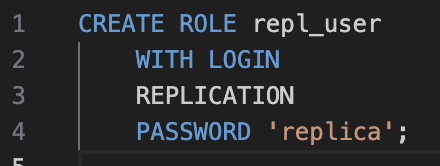

Файл подключила через `bind mount` в `/docker-entrypoint-initdb.d/`, чтобы встроенный `entrypoint` выполнил его при первоначальной инициализации пустого каталога данных.

После этого подготовила `файл pg_hba.conf` с правилами подключения. В нём разрешила локальные подключения внутри контейнера, обычные сетевые подключения с проверкой пароля и физическую репликацию под ролью `repl_user` из подключённой сети. Файл подключила через `bind mount`, а в `command` указала параметр `hba_file`, чтобы PostgreSQL использовал именно мою конфигурацию.

В параметрах запуска `primary` также указала `wal_level=replica`, `max_wal_senders=10` и `wal_keep_size=256MB`. Они задают необходимый уровень WAL, допустимое количество процессов передачи WAL и минимальный объём удерживаемого недавнего журнала.

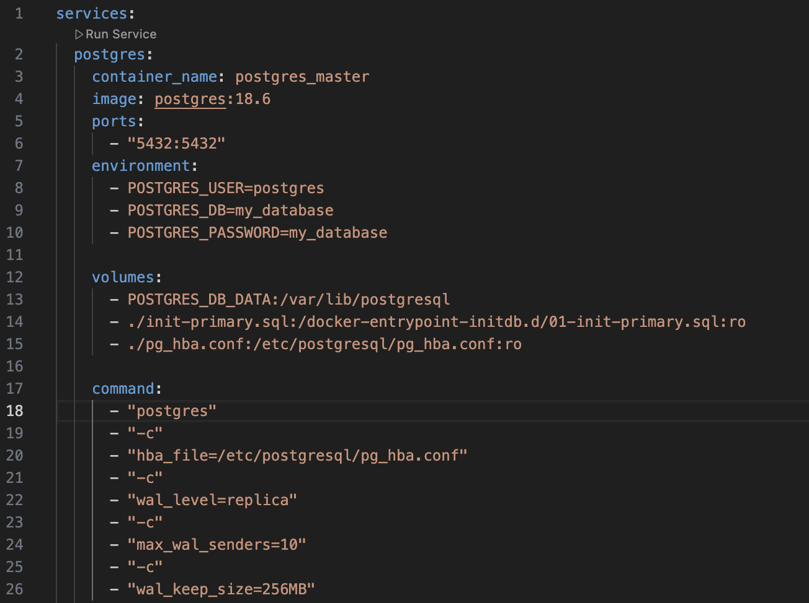

Для проверки запуска primary использую журнал контейнера:

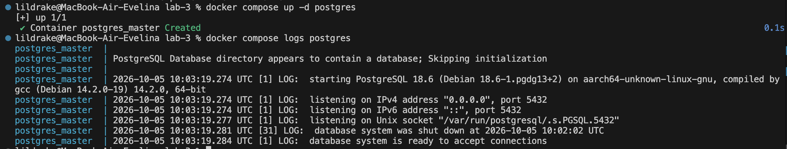

Затем подготалвиваю сервис `postgresql-slave`, чтобы он работал в режиме `standby` (физическая репликация). Для него я подключаю отдельный том и создаю скрипт `init-standby.sh`. Скрипт будет запускаться через `command` при первом запуске он получит начальную копию `primary` с помощью `pg_basebackup`, а затем запустит постгрес на скопированных данных

Параметр `-R` команды `pg_basebackup` будет создавать файл `standby.signal` и записывать настройки подключения к `primary`. Параметр `-X stream` позволит получить необходимый `WAL` одновременно с копированием. После запуска постгрес реплика должна продолжить получать и применять WAL через `streaming replication`.

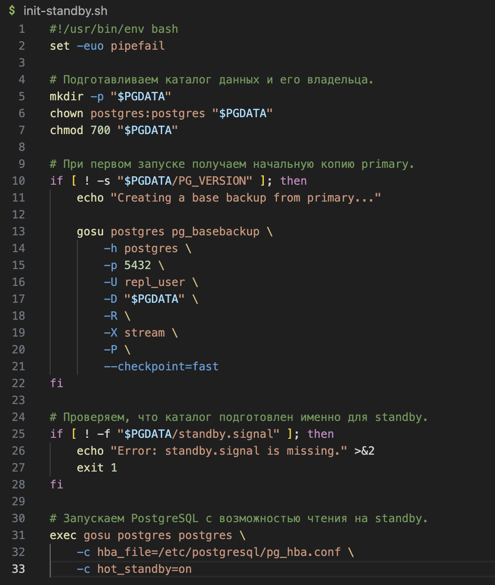

Чтобы копирование не началось раньше готовности primary, я добавила ему `healthcheck` с командой pg_isready. Для `standby` указала зависимость `condition: service_healthy`. Благодаря этому `docker compose` ожидает успешной проверки `primary` перед запуском контейнера реплики.

Хелфчек:

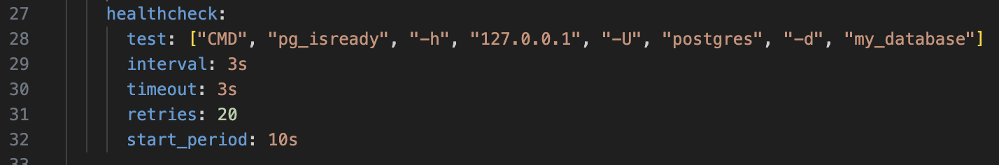

Полученный сервис для репликации:

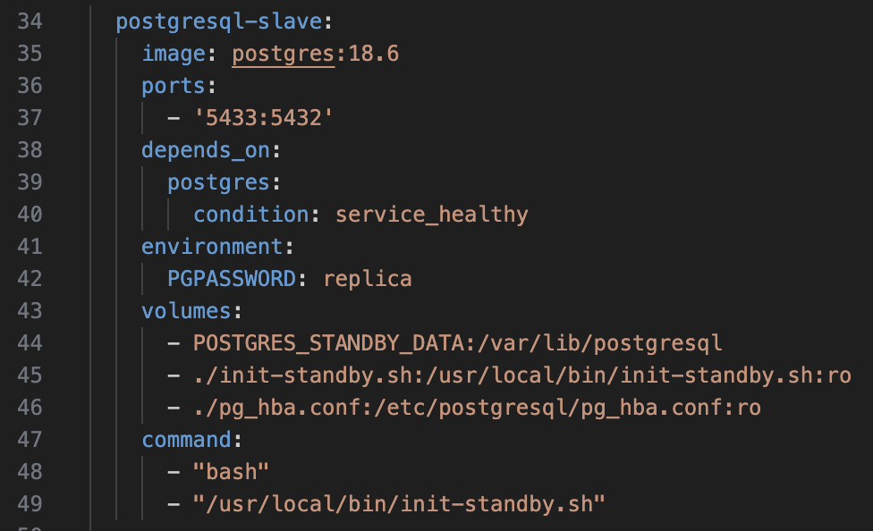

Запускаю сервис и проверяю состояние:

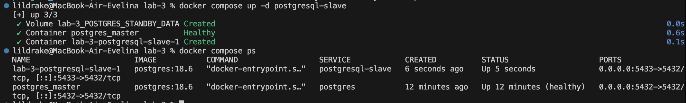

Вывожу логи сервиса:

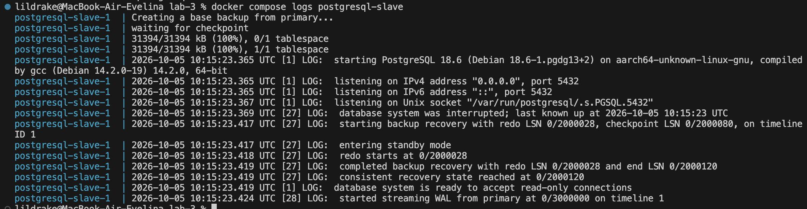

По логам видно, что `pg_basebackup` завершил создание начальной копии данных `primary`

```bash
postgresql-slave-1  | 31394/31394 kB (100%), 0/1 tablespace
postgresql-slave-1  | 31394/31394 kB (100%), 1/1 tablespace
```

Затем постгрес перешел в состояние физической репликации

```bash
postgresql-slave-1  | 2026-10-05 10:15:23.417 UTC [27] LOG:  entering standby mode
```

И сейчас сервер доступен для чтения

```bash
postgresql-slave-1  | 2026-10-05 10:15:23.419 UTC [1] LOG:  database system is ready to accept read-only connections
```

Для проверки, что данные записанные в `primary` появляются и на реплике, захожу внутрь контейнера, создаю таблицу и добавляю запись:

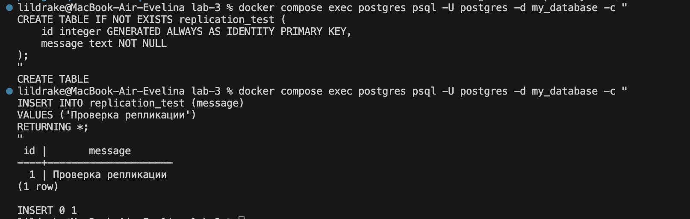

А теперь захожу внутрь контейнера реплики и проверяю, появилась ли запись:

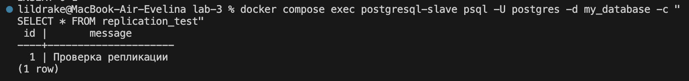

---

## Часть 2 — Подключение подопытного сервиса (read/write splitting)

Сервис генерирую с помощью AI - файл `app.py`. Это будет HTTP-страница с кнопкой "создать запись", список "Записи" будет показывать и читать что лежит в базе, кнопка "Налить нагрузку" будет создавать пачку записей подряд. Создание записи будет идти в `primary`, а чтение записи будет идти с реплики на `stanby`.

Создаю ему `Dockerfile`

```bash
FROM python:3.12-slim
WORKDIR /app
ENV PYTHONDONTWRITEBYTECODE=1 PYTHONUNBUFFERED=1
COPY requirements.txt .
RUN pip install --no-cache-dir -r requirements.txt
COPY . .
EXPOSE 8000
CMD ["python", "app.py"]
```

Так как сервис является клиентом постгреса, я создаю ему роль в `init-primary.sql` и добавляю запись в `pg_hba.conf`:

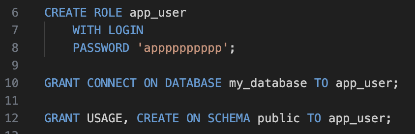

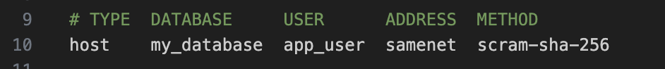

Пересоздаю контейнеры, так как права добавленные в `init-primary.sql` не применились, запускаю только сервис `app`, так как за ним с помощью зависимостей подтянутся и `primary` и `slave`.

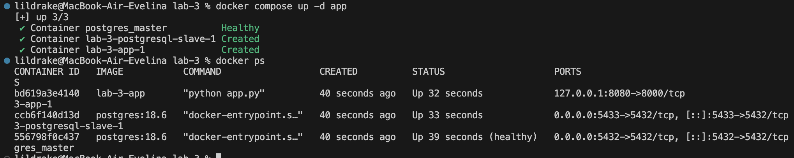

Перехожу по адресу http://127.0.0.1:8080

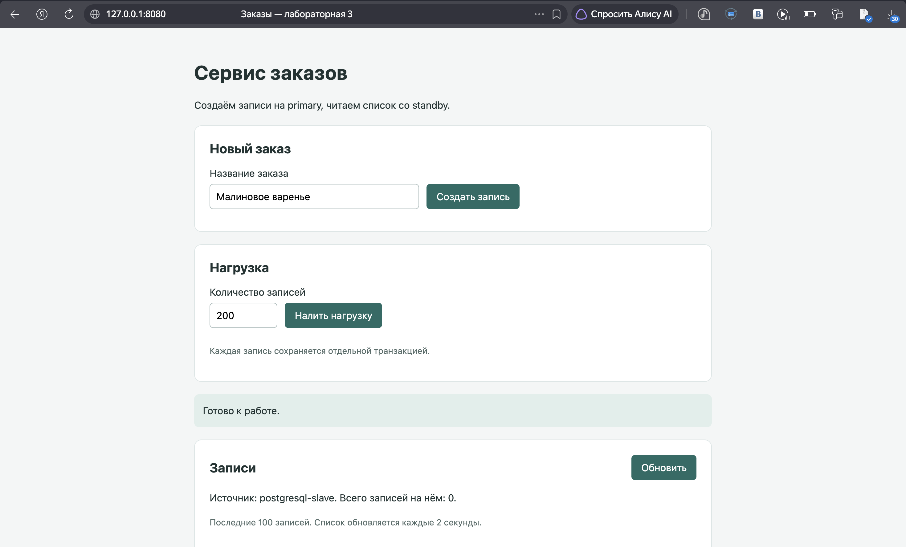

Вроде бы все заработало, но я решила проверить логи сервиса `postgres` и он выдал это

```bash
postgres_master  | 2026-10-05 11:23:48.518 UTC [613] FATAL:  no pg_hba.conf entry for host "127.0.0.1", user "postgres", database "my_database", no encryption
postgres_master  | 2026-10-05 11:23:51.603 UTC [620] FATAL:  no pg_hba.conf entry for host "127.0.0.1", user "postgres", database "my_database", no encryption
postgres_master  | 2026-10-05 11:23:54.672 UTC [627] FATAL:  no pg_hba.conf entry for host "127.0.0.1", user "postgres", database "my_database", no encryption
postgres_master  | 2026-10-05 11:23:57.759 UTC [635] FATAL:  no pg_hba.conf entry for host "127.0.0.1", user "postgres", database "my_database", no encryption
postgres_master  | 2026-10-05 11:24:00.842 UTC [642] FATAL:  no pg_hba.conf entry for host "127.0.0.1", user "postgres", database "my_database", no encryption
postgres_master  | 2026-10-05 11:24:03.928 UTC [649] FATAL:  no pg_hba.conf entry for host "127.0.0.1", user "postgres", database "my_database", no encryption
```

Я удалила подключение для всех в `pg_hba.conf`, то есть общее сетевое подключение, сейчас он принимает подключения только от клиентов, поэтому в файл `pg_hba.conf` добавляю строчку

```bash
# Проверка primary через TCP внутри его контейнера
host    my_database  postgres   127.0.0.1/32   scram-sha-256
```

После этого перечитываю файл внутри контейнера:

```
lildrake@MacBook-Air-Evelina lab-3 % docker compose exec postgres psql -U postgres -d my_database -c "SELECT pg_reload_conf();"
 pg_reload_conf
----------------
 t
(1 row)
```

и заново смотрю логи сервиса `postgres`

```bash
postgres_master  | 2026-10-05 11:27:42.438 UTC [1157] FATAL:  no pg_hba.conf entry for host "127.0.0.1", user "postgres", database "my_database", no encryption
postgres_master  | 2026-10-05 11:27:45.513 UTC [1164] FATAL:  no pg_hba.conf entry for host "127.0.0.1", user "postgres", database "my_database", no encryption
postgres_master  | 2026-10-05 11:27:47.309 UTC [1] LOG:  received SIGHUP, reloading configuration files
```

Создаю запись на интерфейсе и захожу внутрь контейнера `postgres` и проверяю, пояивлась ли она в таблице:

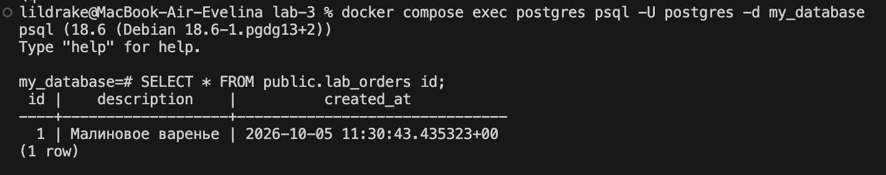

Теперь захожу на реплику и проверяю на ней:

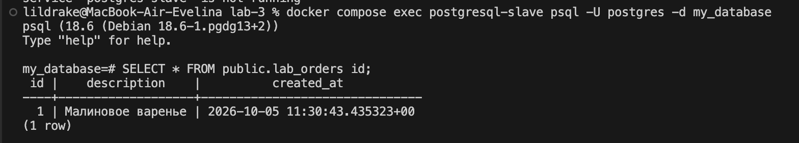

И также в "Записи" появляется строчка с созданной записью:

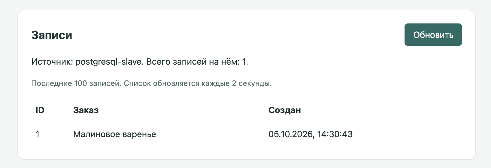

_________
## Часть 3 — Поймать replication lag

Создаю 2000 записей 

> они выполнились очень быстро, ладно...

Создаю 10000 записей

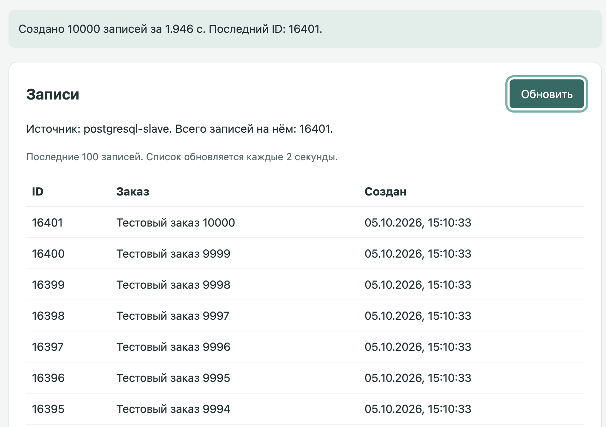

Они тоже быстро выполнились эээ... я даже проверила внутри контейнера таблицы. Даже если и есть задержка, то она очень маленькая - 1.946 секунд

Создаю 100000 записей

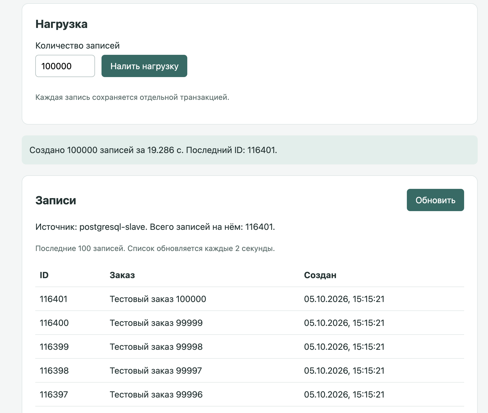

Теперь явно заметна нагрузка

Так как репликация асинхронная происходит следующее: `primary` подтверждает изменение заказа, не дожидаясь, пока реплика не получит и не применит изменения. 

При асинхронной репликации `standby` может временно отставать от `primary`. Из-за этого пользователь может получить подтверждение создания заказа, но ещё не увидеть его в списке, который читается с реплики. Пользователь может решить, что операция не выполнена, и повторно создать заказ. Также чтение устаревших данных может приводить к неполным отчётам и ошибочным решениям приложения.

Другой риск связан с аварийным переключением на `standby`. Если `primary` выйдет из строя до передачи необходимых изменений WAL на реплику, последние подтверждённые записи могут отсутствовать на новом основном узле. 

Эту проблему можно решить с помощью синхронной репликации, но тогда записи будут сохраняться медленнее, так как мейн будет ждать подтверждения от реплики. 

Либо, чтобы уменьшить риски, можно оставить асинхронную репликацию, но при этом следить за отставанием реплики, делать резервные копии и сохранять WAL отдельно. Важные данные сразу после записи можно читать с primary, чтобы пользователь видел созданный заказ. 

Размер отставания можно измерить через pg_stat_replication на primary. Для этого сравниваются текущая позиция WAL на primary и позиция, до которой реплика применила изменения. Разница показывает отставание в байтах WAL по последнему сообщению реплики.

_______
## Часть 4 - Теорема CAP

    теорема `CAP`: из трёх свойств распределённой системы одновременно достижимы только два.
    - `Consistency` — все узлы отдают одни и те же, самые свежие данные; <br/>
    - `Availability` — система отвечает на каждый запрос; <br/>
    - `Partition tolerance` — работает, даже если сеть между узлами разорвана. <br/>

В моей конфигурации запись идёт в `primary`, а чтение с асинхронной реплики. Поэтому после подтверждения создания заказа он может ещё некоторое время отсутствовать в списке. Я думаю, что моя настройка сейчас тяготеет к А, так как если связь между `primary` и standby разорвётся, но приложение сможет подключаться к обоим узлам, `primary` продолжит принимать записи, а standby будет отдавать старые данные, при этом список остаётся доступным, но он уже не будет актуальным. При этом полной доступности всего сервиса нет, так как отказ `primary` остановит запись, а отказ standby остановит чтение списка.

Чтобы усилить согласованность и сместиться в сторону С, можно использовать синхронную реплику и ждать применения изменений, а также можно ограничивать чтения, актуальность которых нельзя подтвердить. Но при потере связи часть операций будет ждать или завершаться ошибкой. Ограничение нагрузки может уменьшить отставание, но оно не решает проблему согласованности при разрыве сети.
______
## Часть 5 — Failover: уронить primary

Останаливаю контейнер `primary` - `postgres`: 

```bash
lildrake@MacBook-Air-Evelina lab-3 % docker compose stop postgres
[+] stop 1/1
✔ Container postgres_master Stopped  
```

Затем через интерфейс пробую создать запись:

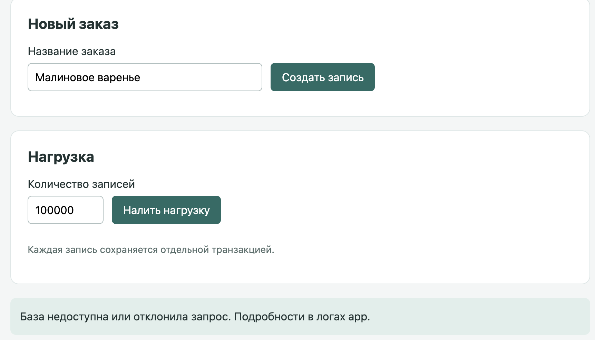

Смотрю логи:

```bash
docker compose logs postgres
...
postgres_master  | 2026-10-14 10:53:00.751 UTC [1] LOG:  database system is shut down
```

`postgres` завершил работу, приложение пытается подключиться к нему для создания заказа, но работающего сервера там уже нет, мы остались без малинового варенья. 

Теперь нужно поработать над `standby`, нужно передать ему команду на переключение и сделатьего основным узлом. Выполняю команду:

```bash
docker compose exec postgresql-slave psql -U postgres -d my_database -c "SELECT pg_promote();"
 pg_promote 
------------
 t
(1 row)
```
`pg-promote()` это функция, которая позволяет повысить реплику и сделать ее основным узлом. После выполнения команды получился резульат `t` - `true` - промоушен завершен. 

А теперь я проверяю, вышел ли узел из восстанавления, перестал ли он принимать WAL от primary:
```bash
docker compose exec postgresql-slave psql -U postgres -d my_database -c "SELECT pg_is_in_recovery();"
 pg_is_in_recovery 
-------------------
 f
(1 row)
```
Все круто, он теперь работает как `primary`.

Теперь нужно изменить адрес записи в сервисе `app`, так как он отправлял записи в `postgres`:
```bash
WRITE_DB_HOST: ${WRITE_DB_HOST:-postgresql-slave}
```
Теперь запускаю контейнер `postgres-slave` без зависимости от `postgres`:
```bash
docker compose up -d --no-deps app
[+] up 1/1
 ✔ Container lab-3-app-1 Recreated 
```
Проверяю контейнеры:

```bash
docker ps -a
CONTAINER ID   IMAGE           COMMAND                  CREATED          STATUS                      PORTS                                         NAMES
1dfefd6182d8   lab-3-app       "python app.py"          54 seconds ago   Up 53 seconds               127.0.0.1:8080->8000/tcp                      lab-3-app-1
ccb6f140d13d   postgres:18.6   "docker-entrypoint.s…"   9 days ago       Up About an hour            0.0.0.0:5433->5432/tcp, [::]:5433->5432/tcp   lab-3-postgresql-slave-1
556798f0c437   postgres:18.6   "docker-entrypoint.s…"   9 days ago       Exited (0) 32 minutes ago                                                 postgres_master
```

Создаю запись на сервисе `app`:

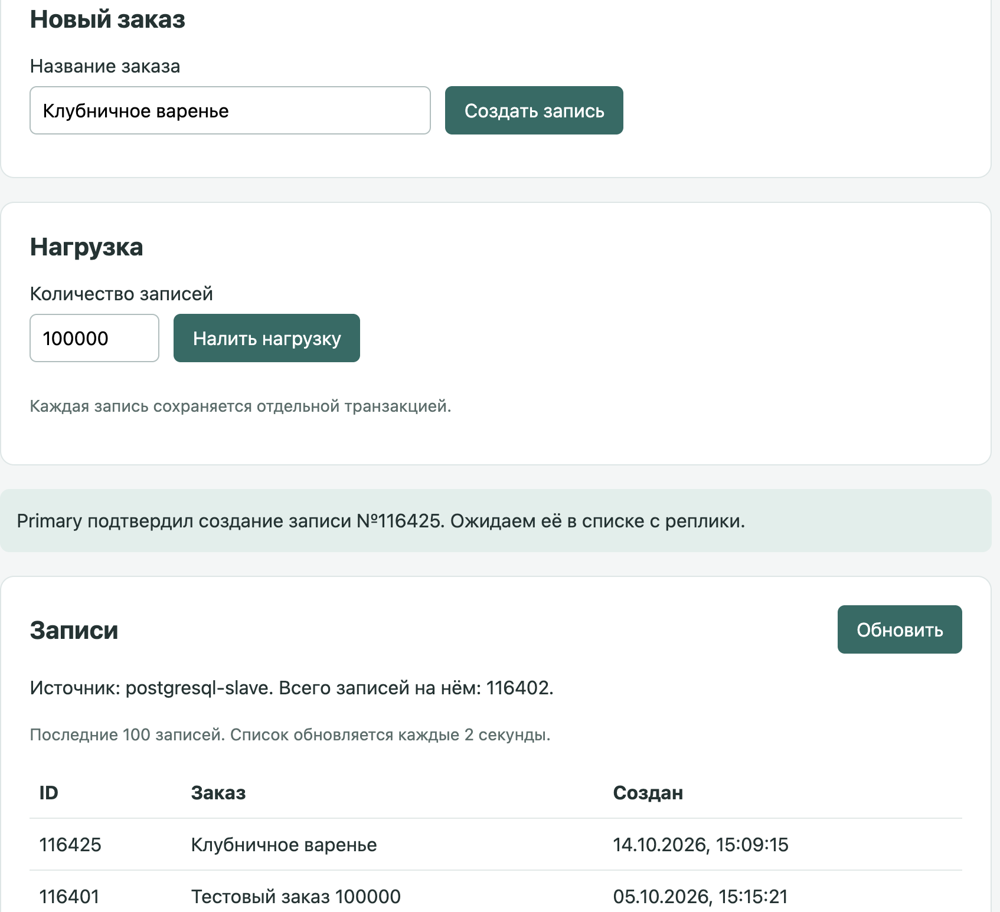

А также проверяю запись в самой базе: 

```bash
docker compose exec postgresql-slave psql -U postgres -d my_database -c "SELECT * FROM public.lab_orders ORDER BY id DESC LIMIT 5;"
   id   |      description      |          created_at           
--------+-----------------------+-------------------------------
 116425 | Клубничное варенье    | 2026-10-14 12:09:15.200953+00
 116401 | Тестовый заказ 100000 | 2026-10-05 12:15:21.331282+00
 116400 | Тестовый заказ 99999  | 2026-10-05 12:15:21.331089+00
 116399 | Тестовый заказ 99998  | 2026-10-05 12:15:21.330944+00
 116398 | Тестовый заказ 99997  | 2026-10-05 12:15:21.330751+00
(5 rows)
```
До отказа запись шла в `primary`, а список заказов читался со `standby`. Я остановила `primary` и попробовала создать заказ "Малиновое варенье". Приложение показало ошибку, поэтому заказ не был сохранён. При этом чтение продолжало работать: в списке оставались ранее полученные репликой записи.

Затем я повысила `standby` до `primary` через `pg_promote()`. После этого поменяла `WRITE_DB_HOST` и пересоздала приложение с новыми настройками. Создание заказа снова заработало, что я проверила через интерфейс и SQL-запрос. Теперь запись и чтение идут на новый `primary`, а старый узел остаётся остановленным.

Если старый `primary` внезапно вернётся, он не станет репликой автоматически. Оба узла будут считать себя основными. Если записывать данные в оба, их содержимое начнёт расходиться и возникнет `split-brain`. Поэтому старый узел нужно исключить из записи и подготовить как `standby` нового `primary`.

В продакшене переключение можно автоматизировать с помощью `Patroni` и `etcd` или `Consul`. Они помогают обнаружить отказ и согласовать выбор нового `primary`. `HAProxy` направляет приложение на текущий основной узел через постоянный адрес. Также нужна защита, которая не позволит старому `primary` продолжать принимать запись.

______
## Часть 6 — Мониторинг 

Меняю сервисы `postgres` - `primary`, `postresql-slave` - `standby`

Добавляю в `docker-compose` сервисы `prometheus`, `grafana`, `alert-manager` и `webhook`.

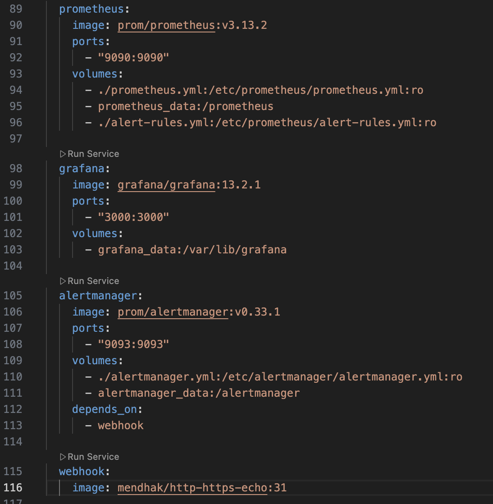

Добавляю файл `prometheus.yml`, в него записываю:

```yml
global:
  scrape_interval: 10s
  evaluation_interval: 5s

rule_files:
  - /etc/prometheus/alert-rules.yml

alerting:
  alertmanagers:
    - static_configs:
        - targets:
            - alertmanager:9093

scrape_configs:
  - job_name: postgres
    metrics_path: /metrics
    static_configs:
      - targets:
          - postgres_exporter:9187
```

1. забирать метрики с `postgres_exporter:9187` каждые 10 секунд
2. каждые 5 секунд проверять правила алертов
3. читать праивла из подключенного файла
4. сработавшие алерты передавать в `alertmanager:9093`

Также добавляю файл `alert-rules.yml` и пока что записываю в него `groups: []`, чтобы проверить работу прометеуса. 

Сам сервис `postgres_exporter` выглядит так:

```yml
  postgres_exporter:
    container_name: exporter_container
    image: prometheuscommunity/postgres-exporter:v0.20.1
    command:
      - --config.file=/etc/postgres_exporter/postgres_exporter.yml
    environment:
      DATA_SOURCE_URI: "postgres:5432/my_database?sslmode=disable"
      DATA_SOURCE_USER: "postgres"
      DATA_SOURCE_PASS: "my_database"
    volumes:
      - ./postgres_exporter.yml:/etc/postgres_exporter/postgres_exporter.yml:ro
    ports:
      - "9187:9187"
    restart: unless-stopped
    deploy:
      resources:
        limits:
          cpus: '0.2'
          memory: 500M
```

Для проверки работы запускаю `postgres_exporter` и `prometheus`:

```bash
docker compose up -d postgres_exporter prometheus 
[+] up 14/14
 ✔ Image prom/prometheus:v3.13.2                       Pulled                                                                                   14.6s
 ✔ Image prometheuscommunity/postgres-exporter:v0.20.1 Pulled                                                                                   5.5ss
 ✔ Volume lab-3_prometheus_data                        Created                                                                                  0.0s
 ✔ Container exporter_container                        Created                                                                                  0.4s
 ✔ Container lab-3-prometheus-1                        Created                                                                                  0.4s
lildrake@MacBook-Air-Evelina lab-3 % docker ps
CONTAINER ID   IMAGE                                           COMMAND                  CREATED          STATUS                    PORTS                                         NAMES
e8875074429f   prom/prometheus:v3.13.2                         "/bin/prometheus --c…"   11 seconds ago   Up 10 seconds             0.0.0.0:9090->9090/tcp, [::]:9090->9090/tcp   lab-3-prometheus-1
bb27706f0776   prometheuscommunity/postgres-exporter:v0.20.1   "/bin/postgres_expor…"   11 seconds ago   Up 10 seconds             0.0.0.0:9187->9187/tcp, [::]:9187->9187/tcp   exporter_container
673bdfbf70ea   lab-3-app                                       "python app.py"          21 minutes ago   Up 21 minutes             127.0.0.1:8080->8000/tcp                      lab-3-app-1
d6217e46fc0a   postgres:18.6                                   "docker-entrypoint.s…"   22 minutes ago   Up 22 minutes             0.0.0.0:5433->5432/tcp, [::]:5433->5432/tcp   lab-3-postgresql-slave-1
de5119e70d7f   postgres:18.6                                   "docker-entrypoint.s…"   31 minutes ago   Up 31 minutes (healthy)   0.0.0.0:5432->5432/tcp, [::]:5432->5432/tcp   postgres_master
```

Захожу на сервис `http://127.0.0.1:9090` и смотрю работу:

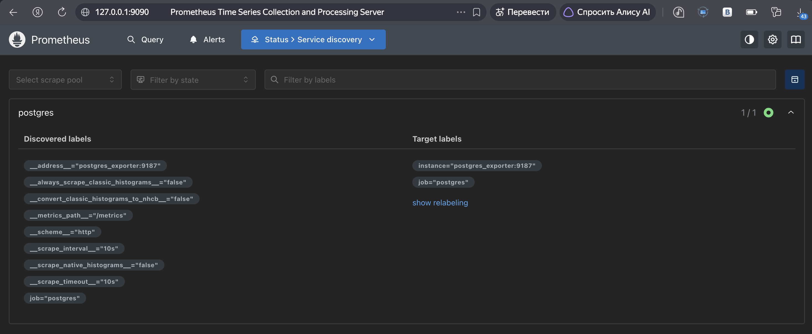

Захожу на сервис `http://127.0.0.1:9187` и смотрю работу:

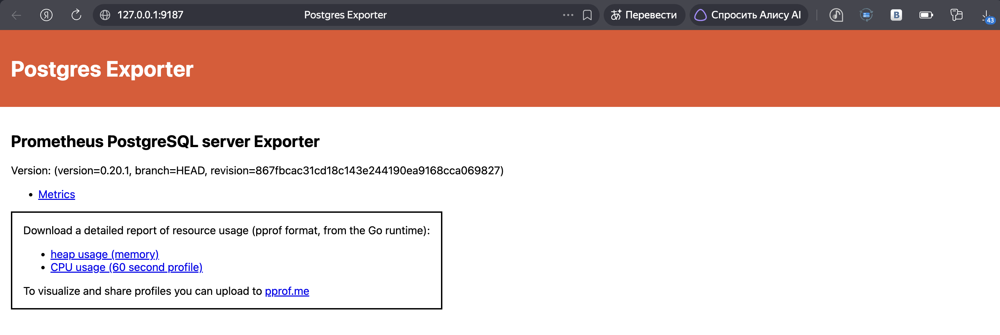

Теперь включаю графану и захожу на нее:

```bash
docker compose up -d grafana
[+] up 13/13
 ✔ Image grafana/grafana:13.2.1 Pulled                                                                                                          54.4s
 ✔ Volume lab-3_grafana_data    Created                                                                                                         0.0s
 ✔ Container lab-3-grafana-1    Created  
docker ps -a
CONTAINER ID   IMAGE                                           COMMAND                  CREATED              STATUS                    PORTS                                         NAMES
77e56350df2b   grafana/grafana:13.2.1                          "/run.sh"                About a minute ago   Up 59 seconds             0.0.0.0:3000->3000/tcp, [::]:3000->3000/tcp   lab-3-grafana-1
```

Перехожу на `http://127.0.0.1:3000`, добавляю новое соединение `http://prometheus:9090`. Содаю дашборд и проверяю:

1. Доступность БД
2. Отставание реплики по WAL
3. Занятые прдключение

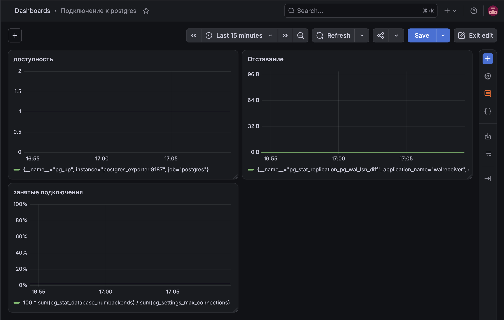

Я выбрала доступность подключения к postgres, чтобы видеть, может ли экспортер подключиться к базе. Если подключение пропадёт, я смогу заметить проблему и проверить postgres, сеть или настройки доступа. Отставание реплики по WAL будет показывать, сколько изменений реплика ещё не применила. Если она отстаёт, пользователь может создать заказ, но некоторое время не видеть его в списке. Процент занятых подключений нужен, чтобы следить, насколько близко база подошла к лимиту соединений. Если свободные подключения закончатся, приложение не сможет открыть новое соединение с postgres, и запросы пользователей могут завершаться ошибкой.

Для проверки работы дашбордов стопаю сервис и смотрю панель:
```bash
docker compose stop postgres
```
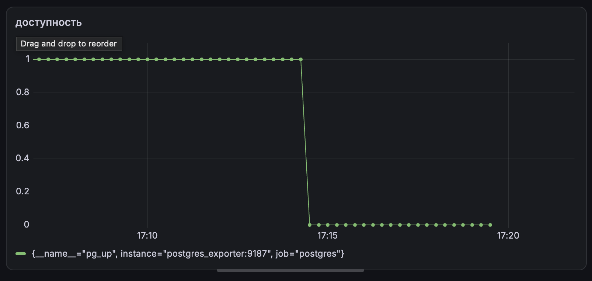

Затем проверяю отставание, создаю очень много записей и смотрю график:

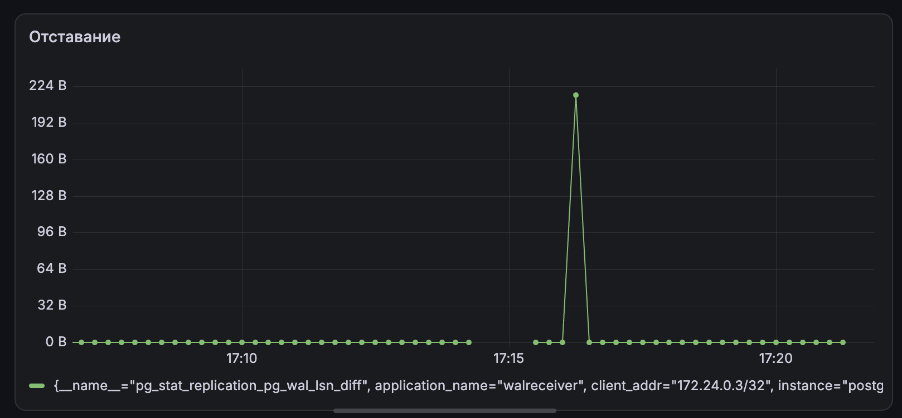

Чтобы проверить соединения нужно создать несколько, поэтому я пишу:

```bash
for i in 1 2 3 4 5; do
  docker compose exec -d postgres psql -U postgres -d my_database -c "SELECT pg_sleep(60);"
done
```
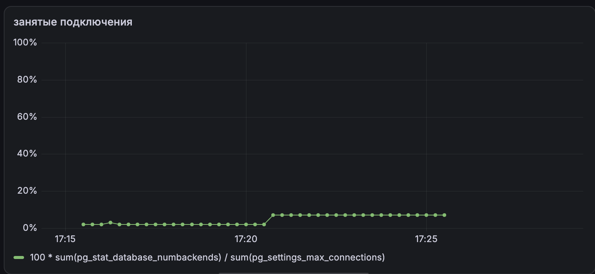

После этого добавляю алерты в `alert-rules.yml` , которые будут уведомлять при отказе базы, отставании больше 1 MiB и если занято больше 80% соединений. 

в `alertmanager.yml` записываю:

```yml
route:
  receiver: local-webhook
  group_by:
    - alertname
  group_wait: 5s
  group_interval: 10s
  repeat_interval: 1m

receivers:
  - name: local-webhook
    webhook_configs:
      - url: http://webhook:8080/
        send_resolved: true
```

Получателем уведомлений будет `webhook`. 

Теперь запускаю `alertmanager` и `webhook`:

```bash
docker compose up -d webhook alertmanager 
[+] up 17/17
 ✔ Image prom/alertmanager:v0.33.1  Pulled                                                                                                      8.9ss
 ✔ Image mendhak/http-https-echo:31 Pulled                                                                                                      12.7s
 ✔ Volume lab-3_alertmanager_data   Created                                                                                                     0.0s
 ✔ Container lab-3-webhook-1        Created                                                                                                     0.2s
 ✔ Container lab-3-alertmanager-1   Created 
 ```

 Проверяю их статус через `docker ps`, перезапускаю сам `prometheus`, перехожу в прометеус и смотрю на алерты:

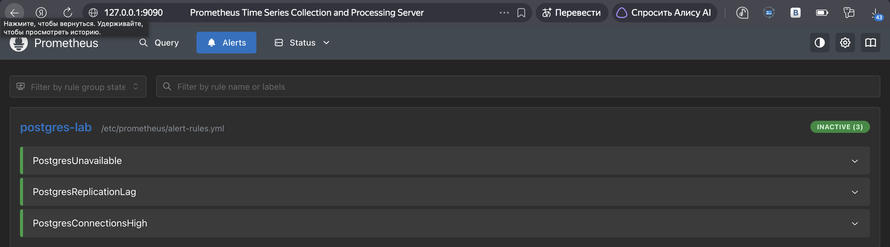

Для проверки работы останавливаю `postgres` и смотрю алерт в `prometheus`:

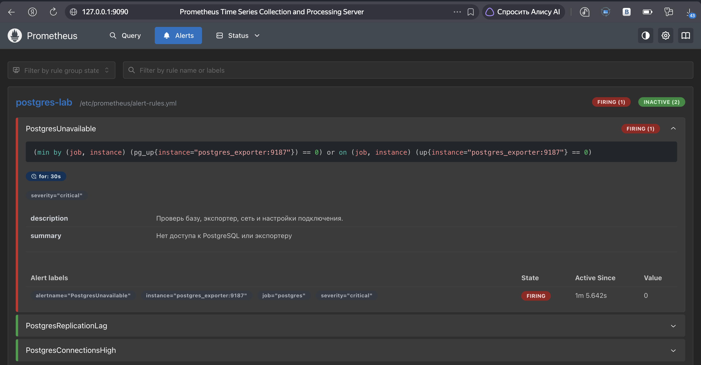

И еще смотрю логи `webhook`:
```bash
docker compose logs webhook
...
webhook-1  |         "commonAnnotations": {
webhook-1  |             "description": "Проверь базу, экспортер, сеть и настройки подключения.",
webhook-1  |             "summary": "Нет доступа к PostgreSQL или экспортеру"
webhook-1  |         },
...
```

______
## ВЫВОД

Эта лаба мне что-то очень тяжело далась, я поняла, что ненавижу постгрес. Я очень старалась вникнуть и понять все процессы, чтобы разобраться в том, как это все работает внутри, как создаются реплики, как это передается. На каждом шаге у меня возникали вопросы - а зачем мне init-standby.sql? а почему нам нужен WAL, ведь он записывает только изменения, разве нам не все записи нужны? А почему он конркетно "так" работает, а что если сделать вот "так"? а зачем мне вот это? а что если я напишу "это" вместо "этого". Короче пипец, я настолько запарилась, что даже попробовала нарисовать схемы работы постгреса

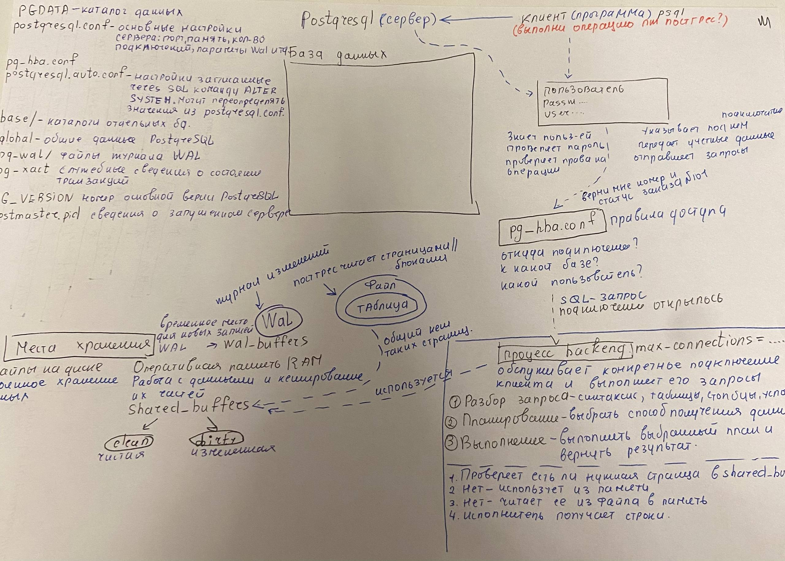

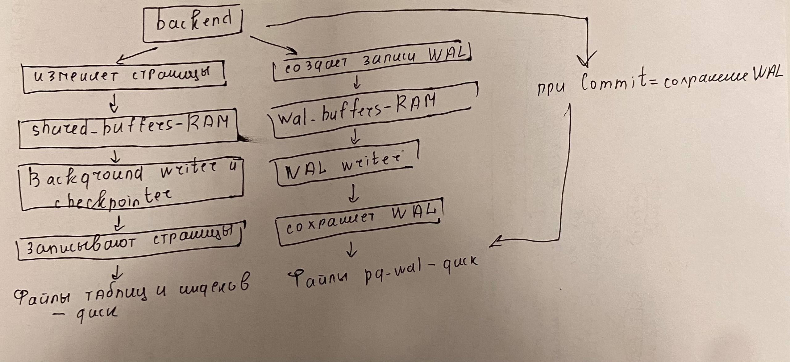

Но по итогу у меня все равно остались некоторые пробелы в понимании, из-за чего я не до конца осознаю, как это все работает😭😭😭😭😭😭😭😭😭😭

С работой реплики я еще норм разобралась, с метриками легко было, но вот ПОСТГРЕС забрал все мои силы...

Возьмите меня на стажировку😇